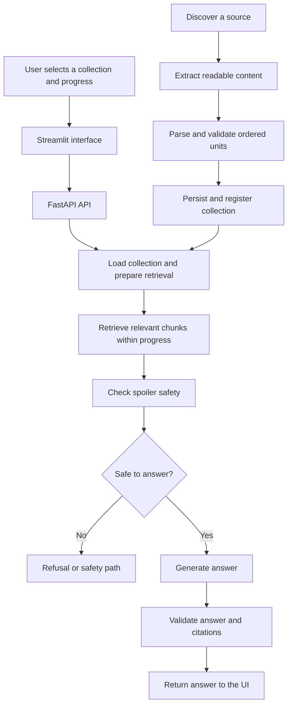

<div align="left">

# Catch Me Up

### Pick up where you left off without jumping ahead.

**Catch Me Up** is a progress aware recap assistant for TV shows and other ordered content. Choose the episode or section you've reached, ask a question, and get an answer grounded in the content available to you.

</div>

---

## The idea

Have you ever returned to a show after a break and forgotten a character, conversation, or plot detail? Searching online can reveal what happens later. Catch Me Up is designed to solve that problem: it lets you ask questions about what you've reached so far, while the app's retrieval and safety workflow considers your selected progress point.

The project combines a Streamlit interface, a FastAPI backend, ordered-content parsing and storage, retrieval, and a LangGraph based question answering workflow.


## Key features

### Progress-aware Q&A
- Select a collection and the episode or ordered unit you've reached.
- Ask questions in natural language about events, characters, details, or concepts.
- Pass the selected progress position into the backend answering workflow.
- Retrieve relevant content and return an answer with supporting evidence where available.

### Spoiler-conscious answering
- The workflow validates the question and requested progress position.
- Relevant chunks are retrieved from the selected collection.
- Safety checks run before answer generation.
- Generated answers go through citation/evidence validation, with retry or refusal paths when needed.

The goal is to reduce spoilers by limiting the information considered and checking the generated response. This is a safety-oriented design, not a guarantee that every possible spoiler will always be caught.

### Source discovery and content import
- Search for useful sources related to a show, book, course, podcast, or other ordered content.
- Extract readable content from a selected source.
- Parse it into ordered units such as episodes, chapters, lessons, or sections.
- Save imported content as a named collection that can be selected in the app.

### Batch episode transcript workflow
- Discover an episode guide.
- Parse season, episode, and title information from supported guide formats.
- Search for transcript pages using the discovered episode details.
- Extract and import usable transcripts as separate episode units.
- Report episodes for which usable transcript content could not be found or extracted.

The completeness of discovery depends on the episode guide and the content returned by the source provider. A site may omit seasons, use an unsupported layout, or have no readable transcript for a particular episode.

## How the application works



## Technology stack

| Technology | How it is used |
|---|---|
| **Python** | Main application language |
| **Streamlit** | User interface for progress selection, discovery, importing, and Q&A |
| **FastAPI** | Backend API connecting the interface to application logic |
| **Pydantic** | Validation of API request and response data |
| **LangGraph** | Orchestration of the question-answering workflow and its conditional paths |
| **HTTPX** | HTTP calls to the backend and external discovery/extraction provider |
| **Tavily** | Web search and readable-content extraction |
| **NumPy** | Numerical operations in retrieval |
| **pytest** | Automated tests for parsing, API behavior, collections, retrieval, and safety logic |

## Project structure

```text
catch-me-up/
├── catchmeup/
│   ├── app.py
│   ├── api.py
│   ├── api_schemas.py
│   ├── collections.py
│   ├── content_parser.py
│   ├── discovery.py
│   ├── discovery_backup.py
│   ├── extraction.py
│   ├── ingestion.py
│   ├── schema.py
│   ├── adapters/
│   │   └── fandom.py
│   └── engine/
│       ├── chunking.py
│       ├── citations.py
│       ├── embedding.py
│       ├── retriever.py
│       ├── spoiler_guard.py
│       ├── workflow.py
│       ├── workflow_generation.py
│       ├── workflow_nodes.py
│       ├── workflow_retrieval.py
│       ├── workflow_retry.py
│       ├── workflow_safety.py
│       ├── workflow_state.py
│       └── workflow_validation.py
├── data/
│   ├── benchmark/
│   ├── processed/
│   └── raw/
├── scripts/
├── tests/
├── requirements.txt
└── README.md
```

## What each important file does

### Interface and API

| File | Description |
|---|---|
| `catchmeup/app.py` | The Streamlit app. Renders the progress sidebar, collection and episode selectors, web source search, automatic episode-transcript discovery, import controls, collection area, and question-answering UI. |
| `catchmeup/api.py` | The FastAPI application. Exposes endpoints for asking questions, discovering sources, extracting content, importing collections, and retrieving collection information. It also prepares the runtime dependencies used for answering questions. |
| `catchmeup/api_schemas.py` | Defines Pydantic models for structured Q&A request and response data. |
| `catchmeup/schema.py` | Defines core data structures used by the ordered-content and retrieval workflow. |

### Discovery, parsing, extraction, and collections

| File | Description |
|---|---|
| `catchmeup/discovery.py` | Builds web-search queries, classifies candidate sources, and ranks results for different content types and search modes. |
| `catchmeup/discovery_backup.py` | Backup copy of discovery logic retained in the repository; the active implementation is `discovery.py`. |
| `catchmeup/extraction.py` | Calls the extraction provider for readable source content, handles provider errors, and limits the amount of text returned. |
| `catchmeup/content_parser.py` | Parses source text, tables, episode guides, and other supported formats into ordered content units. It also cleans common source formatting. |
| `catchmeup/ingestion.py` | Validates collection metadata and parsed units, checks ordering and identifiers, persists the collection data, and registers the collection. |
| `catchmeup/collections.py` | Defines collection configuration and handles collection registry persistence and lookup. |
| `catchmeup/adapters/fandom.py` | Provides source-specific cleaning/adaptation for Fandom-style content. |

### Question-answering engine

| File | Description |
|---|---|
| `catchmeup/engine/workflow.py` | Builds the LangGraph workflow and defines conditional routing between validation, retrieval, safety, generation, citation validation, retries, and stopping. |
| `catchmeup/engine/workflow_state.py` | Defines the state fields shared between workflow stages. |
| `catchmeup/engine/workflow_nodes.py` | Contains initial request validation logic for the workflow. |
| `catchmeup/engine/workflow_retrieval.py` | Runs the evidence-retrieval stage and updates workflow state. |
| `catchmeup/engine/retriever.py` | Ranks content chunks using vector similarity and BM25-style lexical matching, while restricting candidate chunks to those available at the requested progress position. |
| `catchmeup/engine/chunking.py` | Splits ordered content into smaller chunks for retrieval. |
| `catchmeup/engine/embedding.py` | Provides embedding helpers used to represent content and questions for semantic retrieval. |
| `catchmeup/engine/workflow_safety.py` | Applies spoiler-safety checks to retrieved evidence before generation. |
| `catchmeup/engine/spoiler_guard.py` | Contains position-based protection helpers for annotated future outcomes. |
| `catchmeup/engine/workflow_generation.py` | Generates an answer from the evidence accepted by earlier workflow stages. |
| `catchmeup/engine/citations.py` | Contains citation-related helpers and refusal text used by the answer workflow. |
| `catchmeup/engine/workflow_validation.py` | Validates the generated answer and its supporting citations. |
| `catchmeup/engine/workflow_retry.py` | Prepares retry state when an answer fails validation and another attempt is appropriate. |

### Tests, scripts, and data

| Path | Description |
|---|---|
| `tests/` | Automated tests for API routes, schemas, collection persistence, parsing, chunking, retrieval, evidence, and spoiler-safety behavior. |
| `scripts/` | Development and evaluation utilities for inspecting content, testing RAG behavior, generating/reviewing questions, and running retrieval or answer-safety evaluations. |
| `data/processed/` | Processed ordered-content collections and collection registry used by the app. |
| `data/raw/` | Raw or intermediate source material used during content preparation. |
| `data/benchmark/` | Evaluation datasets and review outputs for assessing retrieval and answer safety. |

## Example user flow

1. **Choose a collection** from the progress sidebar.
2. **Select the latest episode or section you've reached.**
3. **Ask a question** in natural language.
4. **Retrieve relevant evidence** from the selected collection, restricted by the chosen progress position.
5. **Check safety and citations** before presenting the answer.
6. **Discover and import more content** when you want to add another collection.

## Evaluation focus

The repository includes test and benchmark material related to:
- Ordered-content parsing and collection persistence.
- API request/response behavior.
- Retrieval quality and evidence selection.
- Citation support for generated answers.
- Spoiler-safety behavior and workflow routing.

These checks are intended to make the workflow more reliable; passing tests does not establish that every external episode guide is complete or every generated answer is spoiler-free.

## Current limitations

- Search results and source classifications are heuristic and may include incomplete or unsuitable pages.
- Episode guides can vary in structure, and some sources may expose only part of a season list.
- Transcript availability and extraction quality depend on the source.
- Imported content may not contain every scene or line from an episode.
- Spoiler-safety checks reduce risk but cannot guarantee perfect spoiler prevention.

---

